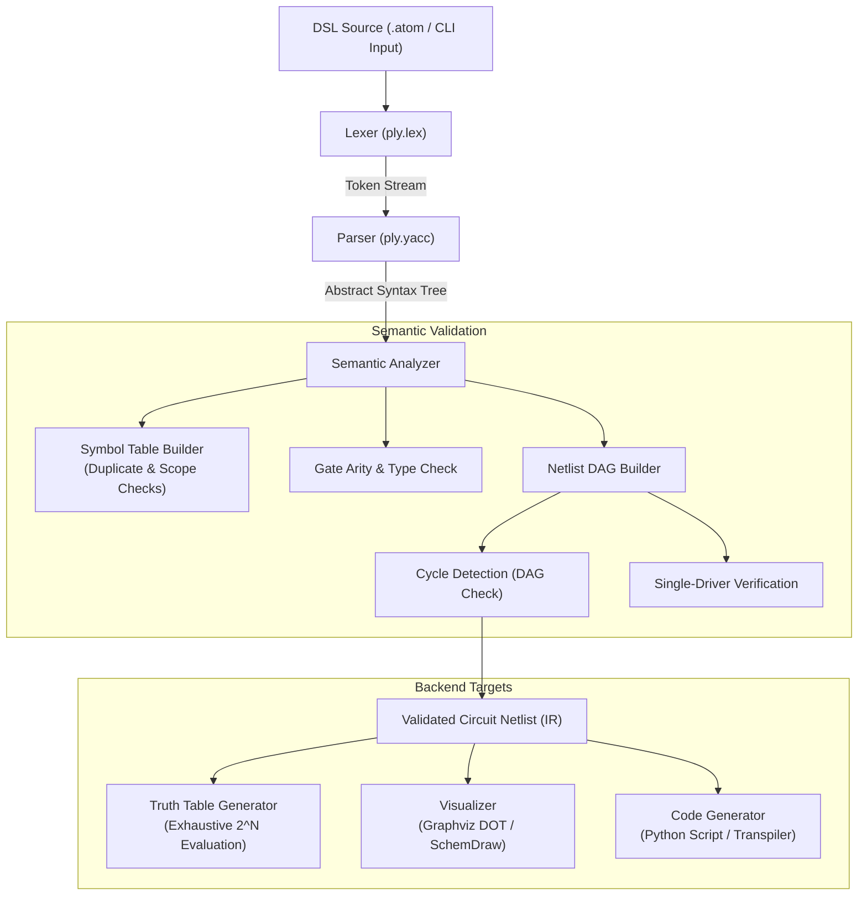

# AtomLogic: Digital Circuit DSL & Translator
## Project Overview, Review, and Technical Specification

> **Document Note**: This document serves as the formal record of the initial project prompt and the comprehensive architectural, technical, and activity breakdown for **AtomLogic**.

---

## 1. Initial Prompt Record

### 1.1 Original Prompt (Portuguese)
"
Estou trabalhando no projeto de criar um tradutor para a disciplina de compiladores da minha faculdade. Criei este repositório para armazenar o código que irei desenvolver. Sobre as tecnologias escolhidas, irei trabalhar com a linguagem Python e a ferramenta PLY. Irei desenvolver uma DSL para descrever circuitos digitais por meio de portas lógicas e conexões. Em vez de desenhar o circuito manualmente, o usuário seria responsável por declarar entradas, portas e saídas. O tradutor deve analisar a descrição ou inputs fornecidos pelo usuário no terminal, verificar a validade das conexões e geraria uma representação do circutio que pudesse ser simulada ou visualizada. O lexer identificaria palavras reservadas, identificadores, operadores e delimitadores. O parser reconheceria as declarações de entradas, portas e saídas e poderia construir uma árvore sintática abstrata (AST). Na análise semântica, o tradutor verificaria se cada sinal utilizado foi declarado, se não existem identificadores duplicados e se cada porta recebe a quantidade correta de entradas. Também poderia detectar ciclos no grafo de dependências do circuito. A saída poderia ser uma tabela-verdade, uma visualizaçao do circuito resultante, até mesmo um programa que simula o circuito para diferentes combinações de entradas. Quero que me ajude a detalhar esse projeto em nível de atividades e tecnologias que podem utilizar. Resenhe sobre o projeto também, mas não implemente nada. Quero que crie um arquivo markdown responsável por registrar esse initial prompt e a sua resposta, use a lingua inglesa."

### 1.2 English Translation
"
I am working on a translator project for the Compilers course at my university. I created this repository to store the code I will develop. Regarding chosen technologies, I will work with the Python language and the PLY tool. I will develop a DSL to describe digital circuits through logic gates and connections. Instead of drawing the circuit manually, the user would be responsible for declaring inputs, gates, and outputs. The translator must parse the description or user inputs provided in the terminal, check the validity of connections, and generate a circuit representation that could be simulated or visualized. The lexer would identify reserved words, identifiers, operators, and delimiters. The parser would recognize declarations of inputs, gates, and outputs and could construct an abstract syntax tree (AST). In semantic analysis, the translator would verify whether each used signal was declared, check for duplicate identifiers, and ensure that each gate receives the correct number of inputs. It could also detect cycles in the circuit dependency graph. The output could be a truth table, a visualization of the resulting circuit, or even a program simulating the circuit for different input combinations. I want you to help me detail this project at the level of activities and technologies that can be used. Also review the project, but do not implement anything yet. I want you to create a markdown file responsible for recording this initial prompt and your response, using the English language.
"

---

## 2. Project Review & Architectural Critique

### 2.1 Concept Assessment
The **AtomLogic** concept is an outstanding fit for an academic compiler construction curriculum:
- **Pedagogical Alignment**: It covers the complete compilation pipeline:
  1. Lexical Analysis (`lex`)
  2. Syntactic Analysis (`yacc` / LALR(1))
  3. Abstract Syntax Tree (AST) Construction
  4. Semantic Analysis & Symbol Table Management
  5. Graph-theoretic Validation (Cycle detection in DAGs)
  6. Code Generation / Multiple Target Backends (truth tables, diagrams, runnable simulation scripts)
- **Focused Scope without Runtime Overhead**: Unlike a general-purpose programming language (which requires complex runtime runtimes, memory management, stack frames, and control-flow jumps), a Hardware Description Language (HDL) / Circuit DSL focuses heavily on **declarative structural specifications**, **dependency analysis**, and **directed acyclic graph (DAG) transformations**. This makes it deep theoretically while keeping the codebase clean and manageable.

### 2.2 Key Architectural Strengths
1. **Natural Graph Mapping**: Digital circuits are fundamentally directed hypergraphs. Transforming an AST into a netlist DAG allows applying classic computer science algorithms (topological sorting, cycle detection via Tarjan/DFS, boolean evaluation).
2. **Multiple High-Impact Outputs**:
   - **Analytical**: Truth table generation via combinatorial evaluation.
   - **Visual**: Diagrammatic rendering (Graphviz DOT or SchemDraw schematics).
   - **Executability**: Generating standalone Python simulator scripts or Verilog/C equivalents.
3. **Rich Semantic Layer**: Checking gate arities, undeclared wires, multiple drivers on a single wire, and cyclic feedback loops provides practical opportunities for detailed compiler diagnostic messages.

### 2.3 Potential Pitfalls & Design Recommendations
- **Combinational vs. Sequential Circuits**:
  - *Recommendation*: Constrain the initial scope strictly to **combinational circuits**. In combinational circuits, cycles (feedback loops) are invalid semantic errors. If sequential logic (flip-flops, latches, clocks) is added later, cycles become valid state elements, which complicates simulation semantics.
- **Single-Driver Principle**:
  - In hardware, connecting two gate outputs to the same wire causes electrical contention (short circuits) unless tristate buffers are used. The semantic analyzer should enforce that each intermediate/output wire has **exactly one driver** (one source).
- **Fan-out Handling**:
  - A single output or input signal can fan out to feed multiple gate inputs. The internal netlist representation must support 1-to-many fan-out cleanly.
- **Error Reporting Quality in PLY**:
  - PLY requires manual line and column tracking (`lexer.lineno`, custom column functions). Build coordinate tracking into tokens from day one so syntax and semantic errors report exact lines and column offsets.

---

## 3. Conceptual DSL Design (Syntax Preview)

To ground the parser and AST design, here is a recommended syntax paradigm for **AtomLogic**:

```dsl
circuit FullAdder {
    inputs: A, B, Cin;
    outputs: Sum, Cout;

    // Internal intermediate signals
    wires: s1, c1, c2;

    // Logic gates: GATE_TYPE(inputs...) -> output;
    XOR(A, B) -> s1;
    XOR(s1, Cin) -> Sum;
    AND(A, B) -> c1;
    AND(s1, Cin) -> c2;
    OR(c1, c2) -> Cout;
}
```

### Supported Gate Primitives
- Standard primitives: `AND`, `OR`, `NOT`, `NAND`, `NOR`, `XOR`, `XNOR`, `BUFFER`.
- Arity rules:
  - `NOT`, `BUFFER`: exactly 1 input.
  - `AND`, `OR`, `NAND`, `NOR`, `XOR`, `XNOR`: 2 inputs (or optionally N >= 2).

---

## 4. Recommended Technology Stack

| Component | Recommended Tool | Rationale |
| :--- | :--- | :--- |
| **Language** | **Python 3.10+** | Native support for pattern matching (`match`/`case` on AST nodes), strong typing (`typing` module), and clean object models. |
| **Lexer & Parser** | **PLY (Python Lex-Yacc)** | Required project technology. Implements LR/LALR(1) parsing, mirroring standard Lex/Yacc tools while remaining purely in Python. |
| **Graph Analysis** | **NetworkX** | De-facto Python library for graph theory. Trivializes topological sorting, dependency checks, and cycle detection (e.g. `simple_cycles`). |
| **Circuit Visualization** | **Graphviz (`graphviz`)** & **SchemDraw** | - **Graphviz**: Emits `.dot` graphs for structural signal-flow diagrams.<br>- **SchemDraw**: Generates professional schematic diagrams with standard IEEE logic gate symbols. |
| **Truth Table Rendering** | **Tabulate** or **Rich** | Renders formatted ASCII/Unicode truth tables directly in the terminal or exports to Markdown. |
| **CLI & Formatting** | **Rich** + **Argparse / Click** | Enables colorful compiler diagnostic errors (pointing arrows, highlighted code snippets, line numbers) and a polished terminal interface. |
| **Testing & CI** | **pytest** | Unit testing for lexer tokens, grammar rules, semantic rejections (cycles, arity mismatches), and simulation output accuracy. |

---

## 5. Compiler Architecture & Pipeline



---

## 6. Work Breakdown Structure (WBS) & Activity Plan

### Phase 1: Formal Language Specification & Grammar Design
- **Activity 1.1: EBNF Grammar Definition**
  - Define the formal Extended Backus-Naur Form (EBNF) for circuit definitions, declaration blocks (`inputs`, `outputs`, `wires`), and gate connection statements.
- **Activity 1.2: Primitive Catalog Definition**
  - Specify the list of reserved gate keywords, acceptable arities (e.g., unary for `NOT`, binary for `AND`), and connection operators (e.g., `->`, `=`, `,`, `;`).
- **Activity 1.3: Example Test Corpus**
  - Write sample circuit scripts:
    - Basic gates: inverter, buffer.
    - Standard circuits: Half Adder, Full Adder, 2-to-1 Multiplexer, 4-bit Ripple Carry Adder.
    - Negative test cases: cyclic circuits, undeclared wires, arity violations, multiple drivers.

### Phase 2: Lexical Analysis (`atomlogic/lexer.py`)
- **Activity 2.1: Token Specifications**
  - Define token lists: keywords (`CIRCUIT`, `INPUTS`, `OUTPUTS`, `WIRES`, gate names), identifiers, delimiters (`{`, `}`, `(`, `)`, `,`, `;`, `:`), operators (`->`).
- **Activity 2.2: Regex Rules & Case Sensitivity**
  - Write regular expressions for tokens with case-handling strategies (e.g., uppercase for gates, case-sensitive identifiers).
- **Activity 2.3: Source Coordinate Tracking & Error Reporting**
  - Implement line number counting and column offset calculation to report exact source positions upon lexical failure.
- **Activity 2.4: Lexer Unit Tests**
  - Write test cases verifying correct tokenization and rejection of invalid characters.

### Phase 3: Syntactic Analysis & AST Construction (`atomlogic/parser.py`, `atomlogic/ast.py`)
- **Activity 3.1: AST Data Model Definition**
  - Implement dataclasses or OOP nodes for `ProgramNode`, `CircuitNode`, `PortDeclarationNode`, `GateNode`, and `IdentifierNode`.
- **Activity 3.2: Context-Free Grammar Rules (`p_rule`)**
  - Define grammar production functions in PLY matching the EBNF.
  - Resolve any Shift/Reduce or Reduce/Reduce conflicts.
- **Activity 3.3: Syntax Error Recovery**
  - Implement `p_error(p)` with clear diagnostic reporting displaying line numbers and expected tokens.
- **Activity 3.4: Parser Unit Tests**
  - Validate parse tree structure for valid inputs and assertion of syntax errors on malformed scripts.

### Phase 4: Semantic Analysis & Graph Validation (`atomlogic/semantic.py`)
- **Activity 4.1: Symbol Table & Scope Management**
  - Build symbol tables storing signal categories (`INPUT`, `OUTPUT`, `INTERNAL_WIRE`) and definition locations.
  - Flag duplicate identifier declarations.
- **Activity 4.2: Connection & Arity Validation**
  - Ensure all gate inputs and outputs reference declared signals.
  - Validate gate arities (e.g., rejecting `AND(A) -> Out` or `NOT(A, B) -> Out`).
  - Enforce the **single-driver rule** (a wire cannot be driven by multiple gate outputs or by an input port).
- **Activity 4.3: Dependency Graph Construction & Cycle Detection**
  - Construct a directed graph of signal dependencies.
  - Execute cycle detection (via DFS or `networkx.simple_cycles` / `is_directed_acyclic_graph`).
  - Report exact cycles if feedback loops are discovered (e.g., `Error: Feedback loop detected: s1 -> gate1 -> s2 -> gate2 -> s1`).
- **Activity 4.4: Semantic Unit Tests**
  - Comprehensive suite asserting expected semantic errors on invalid circuits.

### Phase 5: Intermediate Representation (IR) & Netlist Model
- **Activity 5.1: Topological Sorting**
  - Sort gate execution order topologically so inputs are computed before gate outputs are evaluated.
- **Activity 5.2: Netlist Data Structure**
  - Package inputs, outputs, topologically ordered gates, and internal state into a clean `CircuitNetlist` representation ready for execution.

### Phase 6: Output Generators & Backends
- **Activity 6.1: Combinatorial Simulation & Truth Table Generator (`atomlogic/backends/truth_table.py`)**
  - Generate all $2^N$ input combinations (using `itertools.product([0, 1], repeat=N)`).
  - Simulate gate evaluations sequentially across the topological order.
  - Format output as an aligned table (using `tabulate` or `rich.table`).
- **Activity 6.2: Graphical Circuit Visualizer (`atomlogic/backends/visualizer.py`)**
  - Implement a Graphviz exporter to output a `.dot` file representing signal flow from inputs through gates to outputs.
  - (Optional / Enhanced) Implement a `schemdraw` backend to generate schematic diagrams with logic gate icons.
- **Activity 6.3: Executable Code Generator (`atomlogic/backends/codegen.py`)**
  - Transpile the validated circuit into a standalone Python function or script that can be imported and executed independently.

### Phase 7: CLI Interface, Testing, and Documentation
- **Activity 7.1: Command-Line Interface (`atomlogic/cli.py`)**
  - Build CLI commands:
    - `atomlogic check <file>`: Lexical, syntactic, and semantic validation only.
    - `atomlogic table <file>`: Compute and display the truth table.
    - `atomlogic draw <file> --format png`: Generate graph diagram.
    - `atomlogic compile <file> -o sim.py`: Generate standalone simulator code.
    - Interactive REPL mode: Parse one-liner gate connections in the terminal.
- **Activity 7.2: End-to-End Test Suite**
  - Automated tests running full compilation and simulation of reference circuits (Adder, MUX, etc.).
- **Activity 7.3: Academic Project Report & Documentation**
  - Document the grammar, architecture, AST design, error-handling mechanisms, and demo outputs for submission.

---

## 7. Deliverables & Milestones Summary

| Milestone | Target Deliverables | Key Output Artifacts |
| :--- | :--- | :--- |
| **M1: Specification & Lexer** | EBNF Grammar, Token Definitions, Lexer implementation | Token stream & test suite |
| **M2: Parser & AST** | Yacc grammar rules, AST nodes, Syntax error handler | Formatted AST printout |
| **M3: Semantic Engine** | Symbol Table, Arity Checks, Dependency Graph, Cycle Detector | Diagnostic error reporter |
| **M4: Simulation Engine** | Topological sort, Boolean evaluator, Truth table generator | Terminal Truth Table |
| **M5: Visualization & CLI** | Graphviz/SchemDraw generator, Full CLI interface | Circuit diagrams & CLI tool |
| **M6: Final Report & Presentation** | Academic documentation, test benchmarks, demonstration slides | Final report & test suite |
