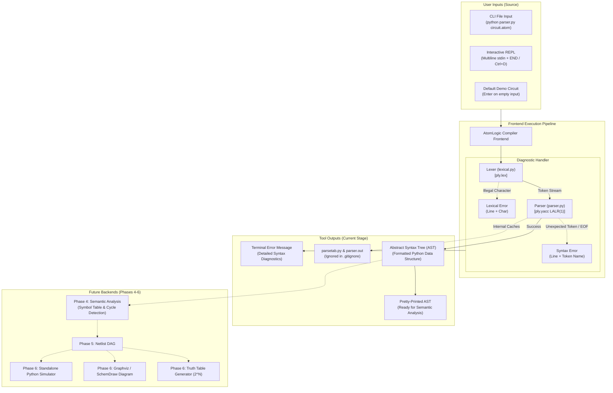

# AtomLogic: Technical Progress & Compilers Theory Report
## Comprehensive Analysis of Architecture, Theoretical Foundations, and Pipeline Status

> **Project**: AtomLogic — Domain-Specific Language (DSL) & Translator for Digital Circuits  
> **Course**: Compilers / Construção de Compiladores  
> **Author**: flaviouss  
> **Technology Stack**: Python 3.10+, PLY (Python Lex-Yacc)  
> **Repository**: [AtomLogic](file:///home/flaviouss/Documents/Repositories/AtomLogic)  
> **Current Date**: October 26, 2026  

---

## 1. Executive Summary

**AtomLogic** is a compiler and translation toolchain for a declarative Domain-Specific Language (DSL) designed to describe, analyze, and simulate digital combinational logic circuits. Rather than manually designing schematics in graphical software, engineers and students define circuit inputs, outputs, logic gates, and interconnections textually.

As of today, **Phases 1, 2, and 3** of the compiler pipeline are complete, operational, and verified:
1. **Phase 1 (Language Specification & Grammar)**: Formal grammar formulated in EBNF, minimal Turing/Boolean complete gate basis `{AND, OR, NOT}` established, and assignment-style wiring syntax (`wire = GATE(in1, in2);`) established.
2. **Phase 2 (Lexical Analysis)**: Implemented in [`lexical.py`](file:///home/flaviouss/Documents/Repositories/AtomLogic/lexical.py) using `ply.lex`. Identifies keywords, identifiers, logic gates, delimiters, strips comments (`//`), and maintains line-number coordinate tracking.
3. **Phase 3 (Syntactic Analysis & AST Construction)**: Implemented in [`parser.py`](file:///home/flaviouss/Documents/Repositories/AtomLogic/parser.py) using `ply.yacc`. Implements an **LALR(1)** shift-reduce parser with **0 conflicts**, builds a clean Abstract Syntax Tree (AST), catches syntax errors with line coordinates, and provides an interactive CLI execution harness.

---

## 2. Theoretical Foundations in Compiler Construction

The architecture of **AtomLogic** directly implements the classical frontend theory of programming language processors.

```
       [Source Code Text]
               │
               ▼
   ┌───────────────────────┐
   │   Lexical Analysis    │  <-- Regular Expressions, Deterministic Finite Automata (DFA)
   │     (lexical.py)      │      Chomsky Type 3 Grammar
   └───────────────────────┘
               │  Token Stream: <TYPE, value, lineno>
               ▼
   ┌───────────────────────┐
   │  Syntactic Analysis   │  <-- Context-Free Grammar (CFG), LALR(1) Automaton
   │     (parser.py)       │      Chomsky Type 2 Grammar
   └───────────────────────┘
               │
               ▼
    [Abstract Syntax Tree]
```

### 2.1 The Chomsky Hierarchy Division
In formal language theory (Chomsky, 1956), languages are classified by the generative power of their grammars:
- **Type 3 (Regular Languages)**: Can be recognized by **Finite Automata** without auxiliary memory (no stack). Used in the **Lexer**.
- **Type 2 (Context-Free Languages)**: Can be recognized by **Pushdown Automata (PDA)** with a Last-In-First-Out (LIFO) stack. Used in the **Parser**.

AtomLogic strictly separates concerns across this boundary:
- **Lexical rules** (keywords, identifiers, numbers, operators) are regular expressions ($R$). They cannot verify balanced brackets `{ ... }` or nested scopes because finite automata cannot count arbitrary depth.
- **Syntactic rules** (matching matching pairs of `{` and `}`, ensuring semicolon terminators, ensuring gate parameter structures) are described by a **Context-Free Grammar (CFG)**.

---

### 2.2 Lexical Analysis (Scanning) Theory & Implementation

The scanner converts an unstructured stream of Unicode characters into a structured sequence of discrete lexical units called **Tokens**.

#### Mathematical Model
Each token corresponds to a formal triple:
$$\text{Token} = \langle \text{TokenType}, \text{AttributeValue}, \text{LineNumber} \rangle$$

For instance, the source text `INPUT A, B;` is transformed into:
1. `Token(INPUT, 'INPUT', line=2)`
2. `Token(ID, 'A', line=2)`
3. `Token(COMMA, ',', line=2)`
4. `Token(ID, 'B', line=2)`
5. `Token(SEMICOLON, ';', line=2)`

#### Finite Automata and Regular Expressions
Under the hood, `ply.lex` compiles regular expressions into non-deterministic finite automata (NFA) using Thompson's construction and then into deterministic finite automata (DFA) using powerset construction.

#### Ambiguity Resolution: Keywords vs. Identifiers
A classic challenge in scanning is the subset collision: `AND` is a valid identifier pattern (`[a-zA-Z_][a-zA-Z0-9_]*`), but it must be reserved as a logic gate token. 

AtomLogic solves this with the canonical compiler approach:
```python
def t_ID(t):
    r'[a-zA-Z_][a-zA-Z0-9_]*'
    t.type = reserved.get(t.value, 'ID')  # O(1) hash table lookup
    return t
```
If `t.value` exists in the `reserved` table, its type is specialized (e.g., `'AND'`, `'CIRCUIT'`); otherwise, it defaults to a generic `'ID'`.

#### Handling Non-Semantic Lexemes (Trivia)
- **Whitespace & Tabs**: Ignored through `t_ignore = ' \t'`.
- **Comments**: Single-line C/Verilog style `//.*` are matched by `t_COMMENT` and discarded (`pass`), preventing extraneous tokens from entering the parser.
- **Line Coordinate Tracking**: The rule `t_newline` detects `\n+` and increments `t.lexer.lineno`, preserving exact source-code location mapping for compiler diagnostics.

---

### 2.3 Syntactic Analysis (Parsing) Theory & Implementation

The parser verifies whether the token stream satisfies the formal syntax defined by the Context-Free Grammar $G = (V, \Sigma, R, S)$, where:
- $V$ is the set of Non-Terminal symbols (`circuit`, `statement_list`, `assign_stmt`, etc.).
- $\Sigma$ is the set of Terminal symbols / Tokens (`CIRCUIT`, `ID`, `EQUALS`, etc.).
- $R$ is the finite relation of Production Rules ($A \to \alpha$).
- $S \in V$ is the Start Symbol (`circuit`).

#### The LALR(1) Shift-Reduce Parsing Algorithm
AtomLogic uses **LALR(1)** (*Lookahead Left-to-Right, Rightmost Derivation with 1 lookahead token*), implemented by `ply.yacc`.

The parser maintains:
1. A **State Stack**: Records automaton states and grammar symbols.
2. An **Input Buffer**: The remaining stream of tokens from the lexer.
3. An **Action Table** and **Goto Table**: Computed automatically by PLY (saved to `parsetab.py` / `parser.out`).

At each step, the parser performs one of four fundamental actions:
- **Shift ($s_n$)**: Consumes the current lookahead token from the input and pushes it onto the stack alongside state $n$.
- **Reduce ($r_k$)**: Replaces a sequence of symbols on top of the stack matching the right-hand side of rule $k$ ($A \to \beta$) with the non-terminal $A$. The reduction invokes the semantic action function `p_rule(p)`.
- **Accept**: The start symbol has been recognized and input is exhausted; parsing concludes successfully.
- **Error**: No valid transition exists for the current state and lookahead token; invokes `p_error(p)`.

#### Conflict Elimination & Grammar Ambiguity
A context-free grammar is invalid for deterministic LALR(1) parsing if it yields:
- **Shift/Reduce conflicts**: The parser cannot decide whether to shift the next token or reduce the current stack.
- **Reduce/Reduce conflicts**: The parser cannot decide which of two distinct rules to reduce.

AtomLogic's grammar is mathematically unambiguous:
$$\text{Shift/Reduce Conflicts: } 0 \quad | \quad \text{Reduce/Reduce Conflicts: } 0$$

#### Left Recursion vs. Right Recursion in LALR Parsers
In LL(1) recursive-descent parsers, left recursion ($A \to A \alpha$) causes infinite recursion. In LALR(1) parsers, **left recursion is optimal**:
```bnf
statement_list ::= statement_list statement
                 | empty
```
Because the reduction occurs immediately as each statement finishes, the parser stack remains at depth $O(1)$. Conversely, right recursion ($A \to \text{statement } A$) forces all statements to be buffered on the stack until the end of the file ($O(N)$ stack memory).

---

### 2.4 Concrete Syntax Tree (Parse Tree) vs. Abstract Syntax Tree (AST)

A **Parse Tree** represents every single grammar deduction, retaining semicolons, commas, and parentheses. This introduces excessive noise for backends.

An **Abstract Syntax Tree (AST)** retains only semantically significant structural information:
- Delimiters (`;`, `,`, `(`, `)`, `{`, `}`) are discarded.
- Statements are structured as nested data structures.

In AtomLogic, the AST is implemented as clean Python tuples:
```python
('circuit', <name>, [
    ('inputs', [<signal_list>]),
    ('outputs', [<signal_list>]),
    ('assign', <target_wire>, ('gate', <op>, [<input_signals>]))
])
```

---

## 3. Tool Pipeline & User Workflow Diagram

The following diagram illustrates the interaction between user inputs, the compiler stages, and the resulting outputs:



---

## 4. How the Tool Works: Detailed Component Walkthrough

### 4.1 The Lexer ([`lexical.py`](file:///home/flaviouss/Documents/Repositories/AtomLogic/lexical.py))
- **File Role**: Defines token regular expressions and lexical conventions.
- **Key Definitions**:
  - `reserved`: Dictionary mapping reserved keywords (`CIRCUIT`, `INPUT`, `OUTPUT`, `AND`, `OR`, `NOT`) to token identifiers.
  - `tokens`: Union of operator/delimiter tokens and reserved keyword values.
  - `t_COMMENT`: Matches `//.*` and silently drops comments without advancing token counters.
  - `t_newline`: Tracks line number increments accurately across multi-line definitions.
  - `t_error`: Gracefully recovers from illegal characters by reporting the offender's line and character before skipping.

### 4.2 The Parser ([`parser.py`](file:///home/flaviouss/Documents/Repositories/AtomLogic/parser.py))
- **File Role**: Implements LALR(1) grammar productions and outputs the AST.
- **Grammar Productions**:
  - `p_circuit`: Matches the outer block `CIRCUIT ID { statement_list }`.
  - `p_statement_list`: Accumulates statements via left recursion.
  - `p_statement`: Dispatches to input declarations, output declarations, or gate assignments.
  - `p_input_decl` / `p_output_decl`: Extracts port identifiers into an array.
  - `p_id_list`: Handles comma-separated identifier lists (`A, B, Cin`).
  - `p_assign_stmt`: Binds an output/intermediate wire to a gate expression (`target = GATE(...)`).
  - `p_gate_expr_not`: Matches unary `NOT(input)`.
  - `p_gate_expr_binary`: Matches binary `AND(in1, in2)` and `OR(in1, in2)`.
  - `p_error`: Catches invalid syntax and unexpected tokens, printing line number and token context.

### 4.3 The CLI Interface & Testing Harness
The entry point in `parser.py` provides:
1. **File Mode**: `python parser.py <filename>` parses any external `.atom` source file.
2. **Interactive Terminal Mode**: Running `python parser.py` opens a REPL where circuits can be typed or pasted directly. Terminate with `END` or `Ctrl+D`.
3. **Automated Fallback**: Pressing Enter on an empty line immediately executes an internal benchmark (`HalfAdder`), validating the parser setup in under 0.1 seconds.

---

## 5. End-to-End Execution Trace

### Example Circuit: Half Adder
```dsl
CIRCUIT HalfAdder {
    INPUT A, B;
    OUTPUT Sum, Carry;

    Carry = AND(A, B);
    NotA = NOT(A);
    Sum = OR(A, B);
}
```

### Generated AST Output
```python
(
    'circuit',
    'HalfAdder',
    [
        ('inputs', ['A', 'B']),
        ('outputs', ['Sum', 'Carry']),
        ('assign', 'Carry', ('gate', 'AND', ['A', 'B'])),
        ('assign', 'NotA',  ('gate', 'NOT', ['A'])),
        ('assign', 'Sum',   ('gate', 'OR',  ['A', 'B']))
    ]
)
```

### Syntax Error Handling Trace
If a user omits a semicolon on line 2 (`INPUT A, B`):
```text
Syntax error at token 'OUTPUT' (line 3)
```
The parser detects that after `INPUT id_list`, only a `SEMICOLON` was acceptable. Because it encountered `OUTPUT`, an informative syntax error is raised immediately.

---

## 6. Project Roadmap & Next Steps

```
[Phase 1: Specs & EBNF]     --> COMPLETED  (PROJECT_SPECIFICATION.md)
[Phase 2: Lexical Analysis] --> COMPLETED  (lexical.py)
[Phase 3: Syntactic Parser] --> COMPLETED  (parser.py -> AST generated)
────────────────────────────────────────────────────────────────────────
[Phase 4: Semantic Analysis] ---> NEXT IMMEDIATE TARGET
   ├─ Build Symbol Table (track inputs, outputs, internal wires)
   ├─ Check undeclared signals and duplicate definitions
   ├─ Verify gate arity (NOT requires 1, AND/OR require 2)
   ├─ Enforce Single-Driver rule (wires cannot have multiple sources)
   └─ Construct Dependency Graph & Detect Cycles (combinational feedback check)
[Phase 5: Intermediate Representation (IR Netlist DAG)]
[Phase 6: Backends]
   ├─ Exhaustive Truth Table Generator (2^N evaluations)
   ├─ Circuit Visualizer (Graphviz DOT & SchemDraw schematic)
   └─ Standalone Python Simulation Code Generator
[Phase 7: Comprehensive CLI & Automated Test Suite]
```

---

## 7. Version Control & Git Configuration
- Updated [`.gitignore`](file:///home/flaviouss/Documents/Repositories/AtomLogic/.gitignore) to exclude:
  - `__pycache__/` and `*.pyc`
  - `parsetab.py` (PLY generated LALR tables)
  - `parser.out` (PLY grammar state diagnostics)
  - `.venv/` (Python virtual environment)
